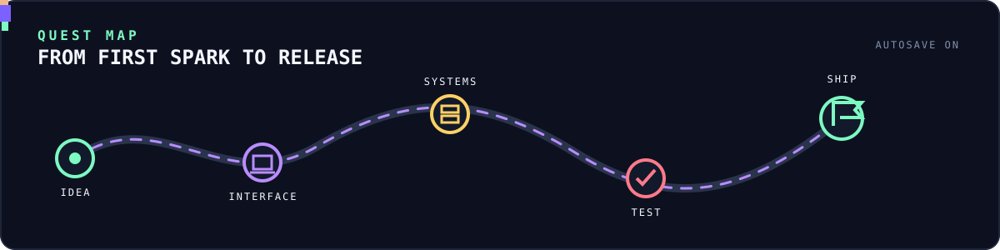
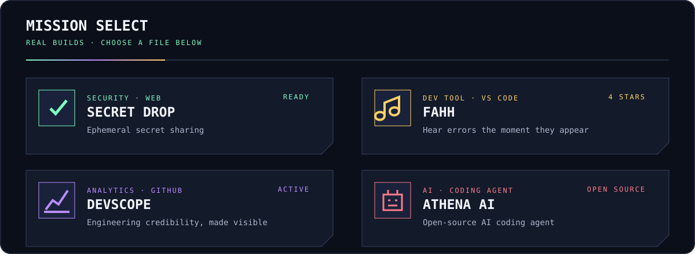
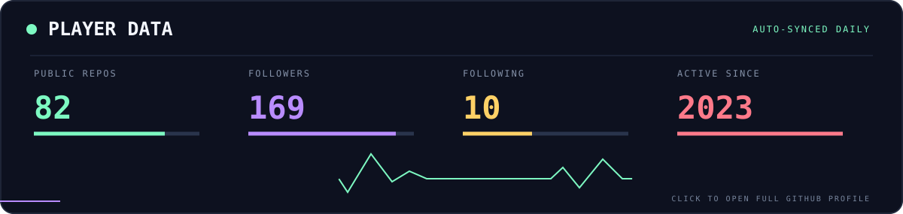

<table>
  <tr>
    <td></td>
    <td></td>
  </tr>
  <tr>
    <td></td>
    <td></td>
  </tr>
</table>

 

 

  <a href="https://github.com/Abi-de-jo/penny"><strong>PENNY</strong></a>
  &nbsp;&nbsp;·&nbsp;&nbsp;
  <a href="https://github.com/Abi-de-jo/phone-guard"><strong>PHONE GUARD</strong></a>
  &nbsp;&nbsp;·&nbsp;&nbsp;
  <a href="https://github.com/Abi-de-jo/opencode"><strong>OPENCODE</strong></a>
  &nbsp;&nbsp;·&nbsp;&nbsp;
  <a href="https://github.com/Abi-de-jo/Athena-AI"><strong>ATHENA AI</strong></a>

 

  

